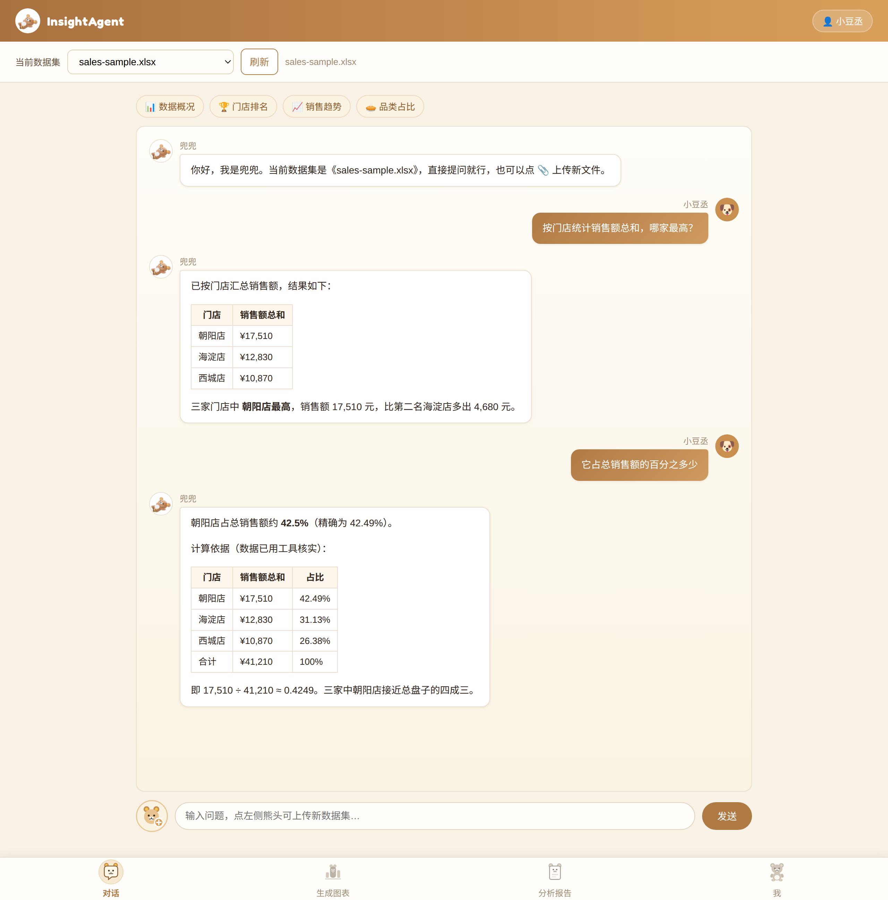
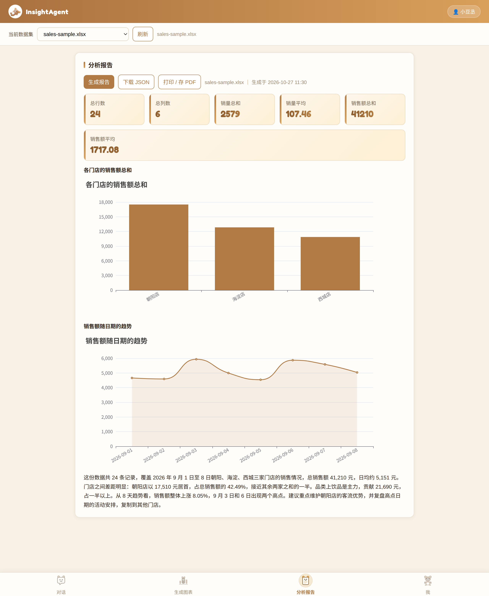

# InsightAgent · 智能数据分析助手

上传一份 CSV / Excel 数据，用自然语言提问，就能得到统计结果、图表和分析报告。

本项目的核心原则是**统计与解读分离**：所有数字都由 Java 计算，大模型只负责解读数据、给出建议，从根上避免模型编造数字。

**对话问答（工具调用 + 多轮记忆）**



**一键分析报告（KPI + 图表 + 模型结论）**



## 功能一览

- **账号**：手机号验证码登录（演示环境下验证码输出在服务端控制台），Token 存入 Redis，双拦截器完成登录校验与 Token 自动刷新
- **数据集管理**：上传 CSV / Excel，EasyExcel 流式读取；大文件异步解析（独立线程池 + 状态轮询），列表实时展示处理中 / 已完成 / 解析失败状态；支持删除数据集，行数据与缓存一并清理
- **数据概况**：逐列类型推断、缺失值与缺失率统计、重复行检测、数值列合计 / 均值 / 最大 / 最小与 IQR 异常值、文本列高频取值；概况结果走 Redis 缓存，重复查看不再重算
- **AI 对话问答**：模型通过工具调用获取真实统计（数据概况、分组统计、趋势分析、图表数据共 4 个工具），支持 SSE 流式输出；接入多轮对话记忆，按「用户 + 数据集」隔离，窗口保留最近 20 条
- **图表生成**：选列即可生成柱状图 / 折线图 / 饼图（ECharts 渲染），图表数据走直连接口，不解析模型文本
- **一键报告**：固定 JSON 结构输出 KPI 卡片、图表与模型结论，支持导出 JSON 与打印为 PDF
- **个人中心**：修改昵称、更换头像，保存后全站同步
- **健壮性**：模型调用失败自动重试（最多 3 次，间隔递增退避），失败才向用户报错

## 技术栈

| 层 | 选型 |
| --- | --- |
| 语言 / 运行时 | Java 21 |
| 后端框架 | Spring Boot 3.5.7 |
| AI 框架 | Spring AI 1.0.9，接入 DeepSeek（deepseek-flash） |
| 持久层 | MyBatis-Plus 3.5.12 + MySQL 8.0 |
| 缓存 / 会话 | Redis（登录 Token、数据概况缓存） |
| 文件解析 | EasyExcel 3.3.4 |
| 接口文档 | Knife4j 4.5.0 |
| 前端 | 原生 HTML + JavaScript 单文件，ECharts 图表，marked 渲染 Markdown |

## 核心设计

```
浏览器（单文件前端）
   │  REST / SSE
Controller ── Service（统计计算 / Redis 缓存 / 异步解析）── MyBatis-Plus ── MySQL
                  │
                  └── ChatClient（Spring AI）── DeepSeek
                          │  工具调用
                          └── DatasetTools ── DatasetService（Java 统计）
```

几个刻意的设计决定：

1. **工具调用拿数，不靠提示词拼数据**。模型要数字时必须调用工具，工具背后是 Java 的统计方法，模型全程接触不到原始数据表，也编不出数字。
2. **流式输出下的用户上下文传递**。流式调用时工具在 Reactor 线程执行，ThreadLocal 中的登录用户会丢失，本项目通过 ToolContext 显式传递 userId，工具内部再恢复上下文。
3. **缓存先验归属再读**。概况缓存的 key 只有数据集 id，读缓存前先校验数据集属于当前用户，避免越权读取；数据集内容不可变，缓存不设过期，删除数据集时主动清理对应 key。
4. **异步解析避开自调用失效**。`@Async` 依赖代理，同类自调用会绕过代理导致注解失效，因此解析逻辑放在独立的 DatasetParseService 中，由上传接口在独立线程池中调度。
5. **报告用固定结构，不解析模型文本**。报告的 KPI 与图表全部由 Java 组装成固定 JSON，模型只写结论文字，前端按模板渲染，排版稳定可控。

## 快速开始

环境要求：JDK 21、MySQL 8.0、Redis。

1. 建库建表：

```sql
CREATE DATABASE IF NOT EXISTS data_agent DEFAULT CHARSET utf8mb4;
USE data_agent;

CREATE TABLE tb_user (
  id BIGINT PRIMARY KEY AUTO_INCREMENT,
  phone VARCHAR(20) NOT NULL,
  nick_name VARCHAR(50) DEFAULT NULL,
  icon VARCHAR(100) DEFAULT NULL,
  create_time DATETIME DEFAULT CURRENT_TIMESTAMP,
  update_time DATETIME DEFAULT CURRENT_TIMESTAMP ON UPDATE CURRENT_TIMESTAMP
);

CREATE TABLE dataset (
  id BIGINT PRIMARY KEY AUTO_INCREMENT,
  user_id BIGINT NOT NULL,
  name VARCHAR(255) DEFAULT NULL,
  file_type VARCHAR(20) DEFAULT NULL,
  row_count INT DEFAULT 0,
  col_count INT DEFAULT 0,
  columns_json TEXT,
  status VARCHAR(20) NOT NULL DEFAULT 'DONE',
  create_time DATETIME DEFAULT CURRENT_TIMESTAMP,
  update_time DATETIME DEFAULT CURRENT_TIMESTAMP ON UPDATE CURRENT_TIMESTAMP
);

CREATE TABLE dataset_row (
  id BIGINT PRIMARY KEY AUTO_INCREMENT,
  dataset_id BIGINT NOT NULL,
  row_index INT NOT NULL,
  data_json TEXT,
  INDEX idx_dataset_id (dataset_id)
);

CREATE TABLE analysis_record (
  id BIGINT PRIMARY KEY AUTO_INCREMENT,
  user_id BIGINT NOT NULL,
  dataset_id BIGINT NOT NULL,
  stats_json TEXT,
  content TEXT,
  create_time DATETIME DEFAULT CURRENT_TIMESTAMP
);
```

2. 准备两个环境变量（可以直接写在 IDE 的运行配置里）：`DB_PASSWORD` 为 MySQL 密码，`DEEPSEEK_API_KEY` 为在 DeepSeek 开放平台申请的 API Key。`application.yml` 中已使用占位符引用，不需要改代码。
3. 启动：在 IDE 中运行 `InsightAgentApplication`，或在项目根目录执行 `mvn spring-boot:run`。
4. 打开 http://localhost:8080 使用；接口文档在 http://localhost:8080/doc.html 。登录时在服务端控制台查看验证码。

## 接口一览

| 方法 | 路径 | 说明 |
| --- | --- | --- |
| POST | /user/code | 发送登录验证码（演示环境输出到控制台） |
| POST | /user/login | 验证码登录，返回 Token |
| GET | /user/me | 当前登录用户 |
| PUT | /user/profile | 修改昵称与头像 |
| POST | /dataset/upload | 上传数据集，返回数据集 id，解析异步进行 |
| GET | /dataset/list | 我的数据集列表（含处理状态） |
| GET | /dataset/{id} | 数据集详情与前若干行预览 |
| GET | /dataset/{id}/overview | 数据概况（走 Redis 缓存） |
| GET | /dataset/{id}/status | 解析状态：PROCESSING / DONE / FAILED |
| DELETE | /dataset/{id} | 删除数据集（行数据与缓存一并清理） |
| POST | /analysis/{datasetId} | 一键分析，生成文字洞察并存档 |
| GET | /analysis/{datasetId} | 历史分析记录 |
| POST | /analysis/chat/{datasetId} | 对话问答（工具调用） |
| POST | /analysis/chat/stream/{datasetId} | 对话问答（SSE 流式） |
| POST | /analysis/chart/{datasetId} | 图表数据直连（ECharts 结构） |
| POST | /analysis/report/{datasetId} | 一键报告（固定 JSON） |

## 项目结构

```
insight-agent
├─ src/main/java/com/xiaodoucheng/insightagent
│  ├─ common       通用返回结构
│  ├─ config       MVC、异步线程池、对话记忆等配置
│  ├─ controller   接口层
│  ├─ service      业务层（数据集管理、异步解析、AI 分析）
│  ├─ tool         供模型调用的工具集
│  ├─ mapper       MyBatis-Plus 映射
│  ├─ entity       实体类
│  └─ utils        用户上下文等工具类
└─ src/main/resources
   ├─ static/index.html    单文件前端
   └─ application.yml
```

## 路线图

- [x] 数据质量检测（重复行、缺失率、IQR 异常值）
- [ ] 追问推荐与简单趋势预测
- [ ] 语音输入（浏览器语音识别与朗读）
- [ ] 屏幕共享理解（接入视觉模型）
- [ ] JavaFX 桌宠客户端

---

本项目为个人学习与求职作品，核心链路（统计、工具调用、报告组装）均为自行实现。
