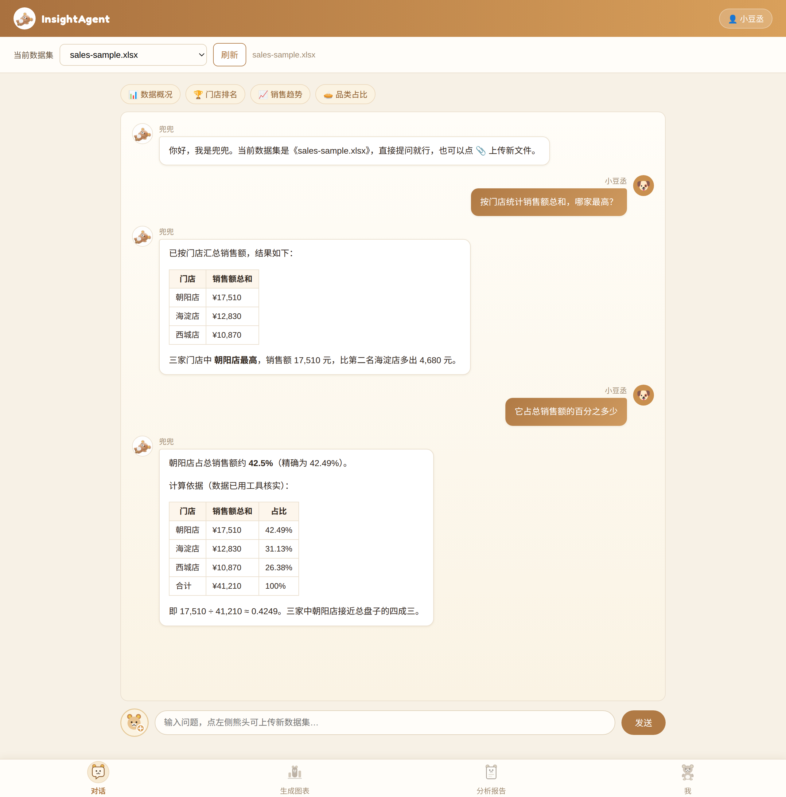
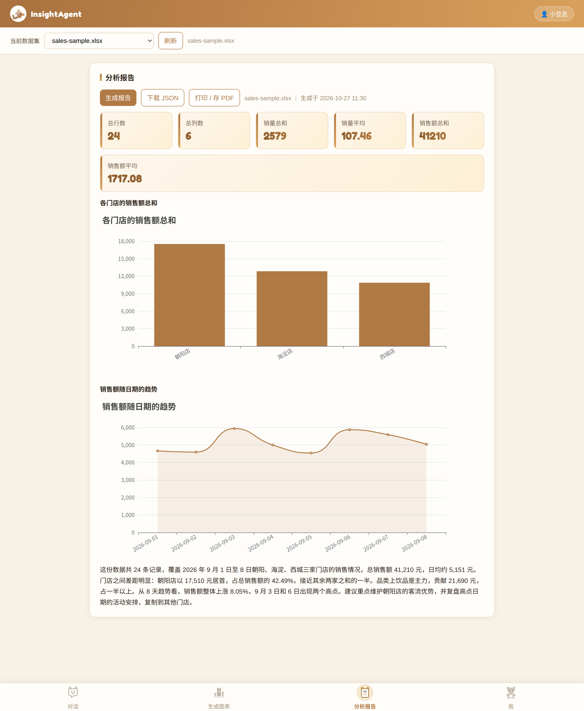
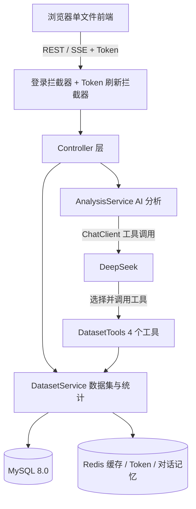

# InsightAgent · 智能数据分析助手

上传一份 CSV / Excel 数据，用自然语言提问，就能得到统计结果、图表和分析报告。

本项目的核心原则是**统计与解读分离**：所有数字都由 Java 计算，大模型只负责解读数据、给出建议，从根上避免模型编造数字。

**对话问答（工具调用 + 多轮记忆持久化）**



**一键分析报告（KPI + 图表 + 模型结论）**



## 功能一览

- **账号**：手机号验证码登录（演示环境下验证码输出在服务端控制台），Token 存入 Redis，双拦截器完成登录校验与 Token 自动刷新
- **数据集管理**：上传 CSV / Excel，EasyExcel 流式读取；大文件异步解析（独立线程池 + 状态轮询），列表实时展示处理中 / 已完成 / 解析失败状态；支持删除数据集，行数据与缓存一并清理
- **数据概况**：逐列类型推断、缺失值与缺失率统计、重复行检测、数值列合计 / 均值 / 最大 / 最小与 IQR 异常值、文本列高频取值；概况结果走 Redis 缓存，重复查看不再重算
- **AI 对话问答**：模型通过工具调用获取真实统计（数据概况、分组统计、趋势分析、图表数据共 4 个工具），支持 SSE 流式输出；接入多轮对话记忆，按「用户 + 数据集」隔离，窗口保留最近 20 条；记忆通过自研 Repository 持久化到 Redis（30 天过期），退出重进、服务重启都不丢，进入数据集自动恢复聊天历史
- **图表生成**：选列即可生成柱状图 / 折线图 / 饼图（ECharts 渲染），图表数据走直连接口，不解析模型文本
- **一键报告**：固定 JSON 结构输出 KPI 卡片、图表与模型结论，支持导出 JSON 与打印为 PDF
- **角色权限**：用户分 USER / ADMIN 两级，基于自定义 `@RequireRole` 注解与拦截器管控 `/admin/**` 管理接口，普通用户只能操作自己的数据，管理员可查看全部用户、管理任意数据集
- **个人中心**：修改昵称、更换头像，保存后全站同步
- **健壮性**：模型调用失败自动重试（最多 3 次，间隔递增退避），失败才向用户报错

## 技术栈

| 层 | 选型 |
| --- | --- |
| 语言 / 运行时 | Java 21 |
| 后端框架 | Spring Boot 3.5.7 |
| AI 框架 | Spring AI 1.0.9，接入 DeepSeek（deepseek-flash） |
| 持久层 | MyBatis-Plus 3.5.12 + MySQL 8.0 |
| 缓存 / 会话 | Redis（登录 Token、数据概况缓存、对话记忆持久化） |
| 文件解析 | EasyExcel 3.3.4 |
| 接口文档 | Knife4j 4.5.0 |
| 前端 | 原生 HTML + JavaScript 单文件，ECharts 图表，marked 渲染 Markdown |

## 架构图



## 核心业务流程

1. **登录**：手机号 + 验证码登录，Token 存入 Redis，拦截器完成登录校验与 Token 自动刷新。
2. **上传与解析**：上传接口校验文件后缀（xlsx / xls / csv）后落库数据集记录（状态 PROCESSING），由独立线程池异步解析，行数据写入 `dataset_row`，前端轮询状态接口展示进度。
3. **数据概况**：先校验数据集归属，再查 Redis 缓存；未命中时由 Java 逐列统计（类型推断、缺失率、IQR 异常值、重复行），结果写回缓存。
4. **对话问答**：模型根据问题自主选择 4 个工具之一取数，Java 完成计算，结果经 SSE 流式返回；对话记忆按「用户 + 数据集」隔离存入 Redis，窗口保留最近 20 条，30 天过期。
5. **图表与报告**：图表数据走直连 REST 接口返回 ECharts 结构；报告由 Java 组装固定 JSON（KPI + 图表），模型只生成结论文字。

## 数据库设计

MySQL 库 `data_agent`，共 4 张表：

| 表 | 用途 | 说明 |
| --- | --- | --- |
| `tb_user` | 用户与角色 | 手机号、昵称、头像、`role` 字段区分 USER / ADMIN |
| `dataset` | 数据集元信息 | 归属用户、文件名、行列数、列定义 JSON、解析状态（PROCESSING / DONE / FAILED） |
| `dataset_row` | 逐行数据 | 每行一条记录，整行以 JSON 存储，适配任意列结构；`dataset_id` 建索引 |
| `analysis_record` | 一键分析存档 | 统计结果 JSON 与模型生成的分析文字 |

关系：一个用户有多个数据集，一个数据集有多行数据，一次分析对应一条存档记录。

Redis 键设计：

- 登录 Token 与验证码
- `insight:dataset:overview:{id}`：数据概况缓存，数据集不可变故不设过期，删除时主动清理
- `insight:chat:memory:{userId}:{datasetId}`：对话记忆，整份消息列表序列化存储，每次保存刷新 30 天过期

## 核心设计

几个刻意的设计决定：

1. **工具调用拿数，不靠提示词拼数据**。模型要数字时必须调用工具，工具背后是 Java 的统计方法，模型全程接触不到原始数据表，也编不出数字。
2. **流式输出下的用户上下文传递**。流式调用时工具在 Reactor 线程执行，ThreadLocal 中的登录用户会丢失，本项目通过 ToolContext 显式传递 userId，工具内部再恢复上下文。
3. **缓存先验归属再读**。概况缓存的 key 只有数据集 id，读缓存前先校验数据集属于当前用户，避免越权读取；数据集内容不可变，缓存不设过期，删除数据集时主动清理对应 key。
4. **异步解析避开自调用失效**。`@Async` 依赖代理，同类自调用会绕过代理导致注解失效，因此解析逻辑放在独立的 DatasetParseService 中，由上传接口在独立线程池中调度。
5. **报告用固定结构，不解析模型文本**。报告的 KPI 与图表全部由 Java 组装成固定 JSON，模型只写结论文字，前端按模板渲染，排版稳定可控。
6. **对话记忆自研持久化**。Spring AI 的记忆接口只定义存取契约，本项目自写 Repository 把整个消息列表（含工具调用与工具返回消息）序列化后存入 Redis，键为 `insight:chat:memory:{userId}:{datasetId}`，每次保存刷新 30 天过期；聊天历史接口从同一份记忆里只挑用户与助手的文本消息返回，工具协议消息不展示给用户。
7. **权限控制不用 Spring Security**。角色校验用自定义注解 + 拦截器实现：`tb_user.role` 区分 USER / ADMIN，`@RequireRole` 标注管理接口，拦截器统一校验，未登录返回 401、无权限返回 403。

## 快速开始

### 方式一：Docker 一键部署（推荐）

环境要求：Docker 与 Docker Compose。

```bash
git clone https://github.com/xdc07/insight-agent.git
cd insight-agent
cp .env.example .env   # 填入 DB_PASSWORD 与 DEEPSEEK_API_KEY
docker compose up -d   # 应用 + MySQL + Redis 三个容器，db/init.sql 自动建表
```

打开 http://localhost:8080 使用，接口文档在 http://localhost:8080/doc.html ，登录验证码在服务端控制台查看。

本地开发时也可以只起中间件：`docker compose -f docker-compose.db-only.yml up -d`（MySQL 映射 3307、Redis 映射 6379），应用在 IDE 中运行。

### 方式二：本地运行

环境要求：JDK 21、MySQL 8.0、Redis。

1. 建库建表：

```sql
CREATE DATABASE IF NOT EXISTS data_agent DEFAULT CHARSET utf8mb4;
USE data_agent;

CREATE TABLE tb_user (
  id BIGINT PRIMARY KEY AUTO_INCREMENT,
  phone VARCHAR(20) NOT NULL,
  nick_name VARCHAR(50) DEFAULT NULL,
  icon VARCHAR(100) DEFAULT NULL,
  role VARCHAR(20) DEFAULT 'USER',  -- USER / ADMIN
  create_time DATETIME DEFAULT CURRENT_TIMESTAMP,
  update_time DATETIME DEFAULT CURRENT_TIMESTAMP ON UPDATE CURRENT_TIMESTAMP
);

CREATE TABLE dataset (
  id BIGINT PRIMARY KEY AUTO_INCREMENT,
  user_id BIGINT NOT NULL,
  name VARCHAR(255) DEFAULT NULL,
  file_type VARCHAR(20) DEFAULT NULL,
  row_count INT DEFAULT 0,
  col_count INT DEFAULT 0,
  columns_json TEXT,
  status VARCHAR(20) NOT NULL DEFAULT 'DONE',
  create_time DATETIME DEFAULT CURRENT_TIMESTAMP,
  update_time DATETIME DEFAULT CURRENT_TIMESTAMP ON UPDATE CURRENT_TIMESTAMP
);

CREATE TABLE dataset_row (
  id BIGINT PRIMARY KEY AUTO_INCREMENT,
  dataset_id BIGINT NOT NULL,
  row_index INT NOT NULL,
  data_json TEXT,
  INDEX idx_dataset_id (dataset_id)
);

CREATE TABLE analysis_record (
  id BIGINT PRIMARY KEY AUTO_INCREMENT,
  user_id BIGINT NOT NULL,
  dataset_id BIGINT NOT NULL,
  stats_json TEXT,
  content TEXT,
  create_time DATETIME DEFAULT CURRENT_TIMESTAMP
);
```

2. 准备两个环境变量（可以直接写在 IDE 的运行配置里）：`DB_PASSWORD` 为 MySQL 密码，`DEEPSEEK_API_KEY` 为在 DeepSeek 开放平台申请的 API Key。`application.yml` 中已使用占位符引用，不需要改代码。
3. 启动：在 IDE 中运行 `InsightAgentApplication`，或在项目根目录执行 `mvn spring-boot:run`。
4. 打开 http://localhost:8080 使用；接口文档在 http://localhost:8080/doc.html 。登录时在服务端控制台查看验证码。

## 接口一览

| 方法 | 路径 | 说明 |
| --- | --- | --- |
| POST | /user/code | 发送登录验证码（演示环境输出到控制台） |
| POST | /user/login | 验证码登录，返回 Token |
| GET | /user/me | 当前登录用户 |
| PUT | /user/profile | 修改昵称与头像 |
| POST | /dataset/upload | 上传数据集，返回数据集 id，解析异步进行 |
| GET | /dataset/list | 我的数据集列表（含处理状态） |
| GET | /dataset/{id} | 数据集详情与前若干行预览 |
| GET | /dataset/{id}/overview | 数据概况（走 Redis 缓存） |
| GET | /dataset/{id}/status | 解析状态：PROCESSING / DONE / FAILED |
| DELETE | /dataset/{id} | 删除数据集（行数据与缓存一并清理） |
| POST | /analysis/{datasetId} | 一键分析，生成文字洞察并存档 |
| GET | /analysis/{datasetId} | 历史分析记录 |
| POST | /analysis/chat/{datasetId} | 对话问答（工具调用） |
| POST | /analysis/chat/stream/{datasetId} | 对话问答（SSE 流式） |
| GET | /analysis/chat/history/{datasetId} | 聊天历史回显（按数据集隔离） |
| POST | /analysis/chart/{datasetId} | 图表数据直连（ECharts 结构） |
| POST | /analysis/report/{datasetId} | 一键报告（固定 JSON） |
| GET | /admin/users | 管理员查看全部用户（需 ADMIN 角色） |

## 项目结构

```
insight-agent
├─ src/main/java/com/xiaodoucheng/insightagent
│  ├─ common       通用返回结构
│  ├─ config       MVC、异步线程池、对话记忆等配置
│  ├─ controller   接口层
│  ├─ service      业务层（数据集管理、异步解析、AI 分析）
│  ├─ tool         供模型调用的工具集
│  ├─ mapper       MyBatis-Plus 映射
│  ├─ entity       实体类
│  └─ utils        用户上下文等工具类
└─ src/main/resources
   ├─ static/index.html    单文件前端
   └─ application.yml
```

## 路线图

- [x] 数据质量检测（重复行、缺失率、IQR 异常值）
- [x] 对话记忆 Redis 持久化与聊天历史回显
- [x] 角色权限 RBAC 与 Docker Compose 部署
- [ ] 追问推荐与简单趋势预测
- [ ] 语音输入（浏览器语音识别与朗读）
- [ ] 屏幕共享理解（接入视觉模型）
- [ ] JavaFX 桌宠客户端

---

本项目为个人学习与求职作品，核心链路（统计、工具调用、报告组装）均为自行实现。
